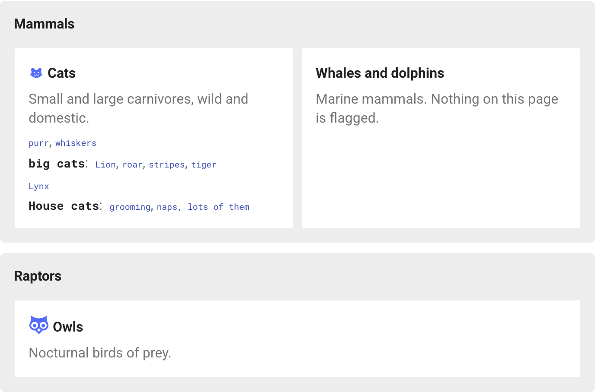
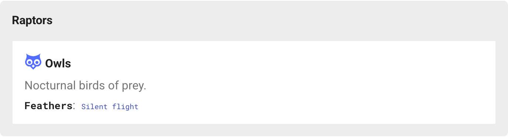
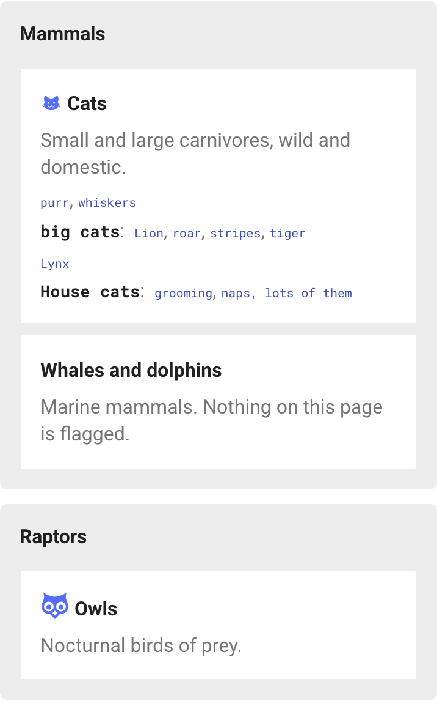

# mkdocs-cheatsheet

A Material for MkDocs plugin that builds a linked cheatsheet from headings you flag across your site. Each page becomes a card. Under the card title and description, each flagged `##` heading becomes a bold line followed by a comma-separated list of links to the flagged headings beneath it:

> **Cats**
> Small and large carnivores, wild and domestic.
> `purr`, `whiskers`
> **`big cats`:** `Lion`, `roar`, `stripes`, `tiger`



The grid is generated at build time, so it needs no JavaScript. Every link points at a heading ID read from the built page, so a renamed heading carries its entry with it. The plugin can also replace the header logo with a "Cheatsheet" button.

## Install

```bash
pip install mkdocs-cheatsheet
```

```yaml
plugins:
  - search
  - cheatsheet
```

## Place the cheatsheet

Put a placeholder anywhere in a page:

```markdown
<!-- cheatsheet -->
```

By default it covers every page in the placeholder page's own nav section, or the whole nav when the page sits at the top level. Cards follow nav order and are grouped under the title of the nav section each page belongs to.

Optional arguments:

| Argument | Effect |
|---|---|
| `section="birds/"` | Only pages whose path starts with this prefix |
| `exclude="drafts/, old/"` | Skip pages under these prefixes |
| `class="wide"` | Extra classes on this grid's container |

A page can hold several placeholders, for example two grids with your own heading between them. Prefixes are paths inside `docs/`; a trailing slash is added if missing, so `section="birds"` does not also match `birds_old/`. An unknown argument logs a warning. A placeholder shown inside a code block is left alone.

**Nested cheatsheets.** If a nav section's index page (`index.md`) has its own placeholder, a cheatsheet higher up shows that section's pages as title-and-description cards only. The full detail lives on the section's own cheatsheet. Pages that hold a placeholder never appear as cards themselves. In the screenshots above, the Owls card is summarized on the homepage because the Birds section has its own cheatsheet:



On narrow screens groups and cards stack into one column:



## Flag headings

Add a marker in braces at the end of a heading:

| Marker | Meaning |
|---|---|
| `{cs}` | Include, using the heading text as the label |
| `{cs=lion}` | Include under a custom label |
| `{cs="tiger, stripes"}` | Several labels, each a link to this heading |
| `{cs="naps\, lots of them"}` | A literal comma inside one label |
| `{cs-skip}` | Exclude (only needed with `default: include`) |

The marker works alongside `attr_list` attributes in the same braces: `## House cats { .wide cs="house cats" data-level="advanced" }`. It is removed from the rendered page, and markers inside fenced code blocks are ignored.

What each heading level does:

- **`#` (h1).** Its labels appear at the top of the card, above the first `##` line, and link to the top of the page. Use this for items that belong to the page as a whole rather than any one section (`# Cats {cs="whiskers, purr"}`).
- **`##` (h2).** Starts a line. The first label is shown in bold and followed by a colon. Any further labels become links in that line that point back to the `##` heading itself.
- **`###` and deeper.** Become the comma-separated links in the line of the nearest `##` above them.

> **Note:** a `##` line only shows its bold label if the `##` heading itself carries a marker. Flagging a `###` does not add its parent `##` to the cheatsheet. The `###` links still appear, on a line with no bold label.

**Carried attributes.** Any `data-*` attribute on a flagged heading is copied onto its cheatsheet entry: the whole line for a `##`, or a `<span>` around the link for deeper headings. This lets other plugins that act on `data-*` attributes, such as content filters, apply to the cheatsheet the same way they apply to the page.

## Card front matter

```yaml
---
description: Wild and domestic cats.        # used when cheatsheet_description is absent
cheatsheet_description: Small and large carnivores, wild and domestic.
cheatsheet_title: Cats                      # default: the page's h1 text, then its nav title
cheatsheet_icon: material-cat               # default: the icon in the page's h1, if any
cheatsheet_title_suffix: ":material-language-python:{ .badge title='Built-in' }"  # inline markdown after the title
cheatsheet_attrs:                           # attributes on the card's <li>
  data-level: advanced
cheatsheet: false                           # leave this page out entirely
---
```

`cheatsheet_description` and `cheatsheet_title_suffix` are rendered as inline markdown with the site's extensions, but outside any page, so relative links in them do not resolve. A page with nothing flagged still gets a card with its title and description. When every card in a group shares a `cheatsheet_attrs` value, the group carries it too.

## Configuration

```yaml
plugins:
  - cheatsheet:
      default: exclude        # or include: every ## and deeper heading is included unless {cs-skip}
      sort: source            # or alphabetical, within each line
      code: true              # render labels as <code>
      marker: cs              # rename the marker keyword
      button: false           # header "Cheatsheet" button, see below
      button_label: Cheatsheet
      group_heading_level: 2
      group_titles:           # rename nav sections for the cheatsheet only
        Mammalia: Mammals
      container_class: []     # extra classes on generated elements
      group_class: []
      summary_group_class: [] # only groups shown as title-and-description cards
      group_title_class: []
      card_class: []
```

## Header button


`button: true` hides Material's header logo and puts a "Cheatsheet" button in its place, linking to the homepage. On the homepage the button shows as active and carries `aria-current="page"`. The button requires a placeholder in the root `index.md`; otherwise it would take away the only header link home, so the plugin logs a warning and leaves the logo in place.

## Styling

Every color and size is a CSS custom property that defaults to Material's own theme variables. Override them in your `extra_css` on `:root, [data-md-color-scheme]`, not `:root` alone. Material sets the color scheme on `<body>`, so an override on `:root` that refers to a theme variable keeps its light-mode value in dark mode:

```css
:root,
[data-md-color-scheme] {
  --md-cheatsheet-button-active-bg: var(--md-default-fg-color);
}
```


| Property | Default |
|---|---|
| `--md-cheatsheet-group-min-width`, `-group-gap`, `-group-padding`, `-group-radius` | `22rem`, `0.6rem`, `0.8rem`, `0.3rem` |
| `--md-cheatsheet-group-bg`, `-group-title-color` | Material foreground tints |
| `--md-cheatsheet-card-min-width`, `-card-gap`, `-card-padding`, `-card-radius` | `11rem`, `0.8rem`, `0.5rem 0.7rem`, `0.2rem` |
| `--md-cheatsheet-card-bg`, `-card-border`, `-card-hover-ring` | page background, transparent, accent |
| `--md-cheatsheet-icon-color`, `-title-color`, `-description-color` | accent, foreground, light foreground |
| `--md-cheatsheet-parent-color`, `-term-color`, `-term-hover-bg`, `-term-size`, `-separator-color` | foreground, link color, accent tint, `0.62em`, light foreground |
| `--md-cheatsheet-focus-ring` | accent |
| `--md-cheatsheet-button-fg`, `-button-bg`, `-button-border`, `-button-radius` | header text, transparent, header text, `1rem` |
| `--md-cheatsheet-button-active-fg`, `-button-active-bg`, `-button-icon` | inverted header colors, a dashboard icon `url()` |

Class hooks: `.md-cheatsheet`, `.md-cheatsheet__group` (with `--summary` and `--cards-N`, plus `data-cheatsheet-cards="N"`), `.md-cheatsheet__group-title`, `.md-cheatsheet__card`, `.md-cheatsheet__title`, `.md-cheatsheet__title-link`, `.md-cheatsheet__icon`, `.md-cheatsheet__description`, `.md-cheatsheet__row` (with `--top` and `--orphan`), `.md-cheatsheet__parent`, `.md-cheatsheet__term`, `.md-cheatsheet__term-wrap`, `.md-cheatsheet-button` (with `--active`).

The whole card is always clickable: the title link stretches over the card, and the other links sit above it and stay clickable on their own.

## Limitations

- Only pages listed in `nav` get cards.
- With `mkdocs serve --dirty`, only changed pages are rebuilt, so a cheatsheet can show stale entries until a full rebuild.
- The generated grid is not added to the search index. MkDocs' search plugin reads each page before the grid is inserted, so the cheatsheet page does not match every keyword on the site.
- Markers are rewritten on any line that looks like a heading outside fenced code blocks. A heading-like line inside a 4-space-indented code block is rewritten too; use fenced code blocks for examples.
- `attr_list` must be enabled; the plugin logs a warning if it is not.

## Development

```bash
pip install -e '.[test]'
playwright install chromium
pytest
```

`python screenshots/capture.py` regenerates the README screenshots from the fixture site.

The tests build `tests/fixture_site/` and check the generated markup, then use Playwright to test the button, card click-through and keyboard focus, and run axe-core accessibility checks.
